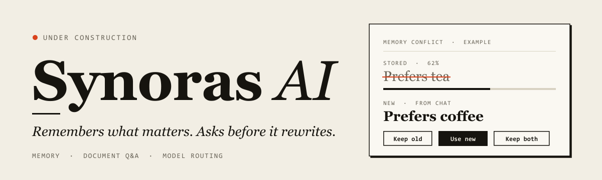

  

<h2 align="center">🚧 Something cool is coming 🚧</h2>

  
  

  
  
  
  
  
  
  
  
  
  
  

---

## What is Synoras AI?

Most AI chat tools forget you the moment the conversation ends. **Synoras AI** is being built to be different:

- 🧠 **Memory that stays honest.** It remembers useful things from your chats, lets that memory fade if it is never confirmed, and asks you before changing anything that contradicts it.
- 📁 **Project workspaces.** Chats, tasks and notes for each project live together.
- 📄 **Ask your own documents.** Upload PDF, TXT or Markdown files and get answers with sources.
- 🤝 **A team of AI agents.** Planning, research, review and answer-writing are shared between agents, and each small job goes to a model of the right size to save cost and time.
- 🧾 **PDF reports** of your work, including how the AI reached its answers.

## Status

The project is in its early build phase. Nothing is ready to use yet. Check back soon.

## Stack

Next.js · React · TypeScript · Tailwind CSS · FastAPI · LangChain / LangGraph · PostgreSQL + pgvector · Redis · Celery · Ollama · Node.js · Docker

---

Built as a final year project. Stay tuned. ✨

